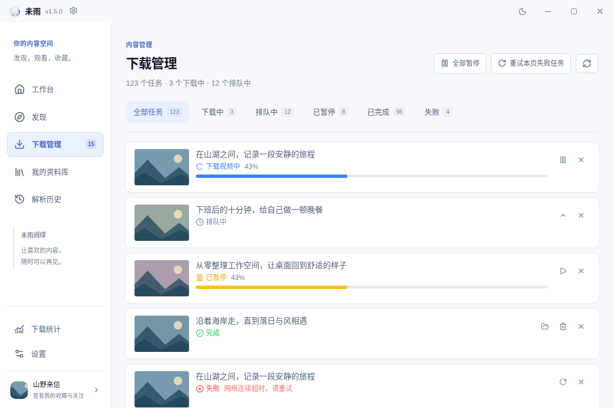
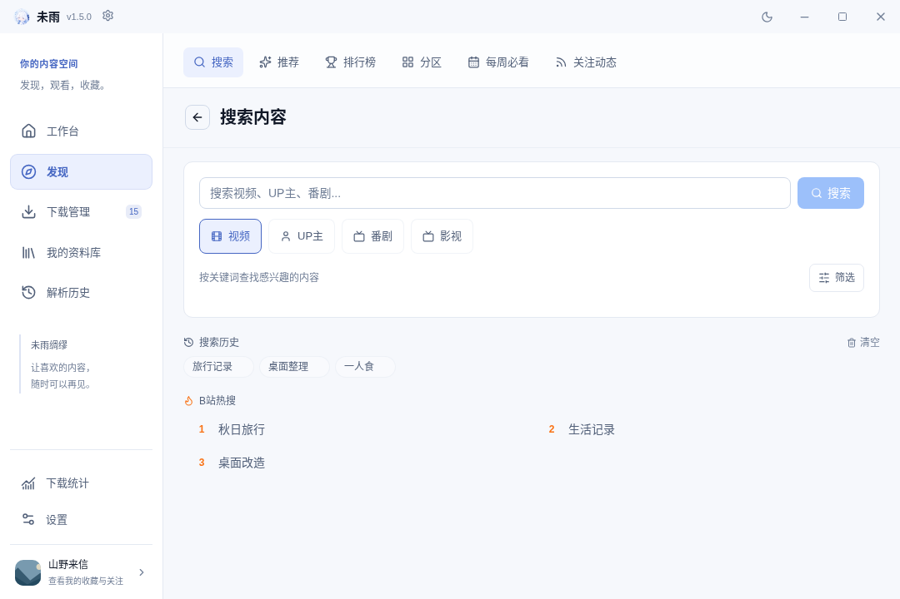
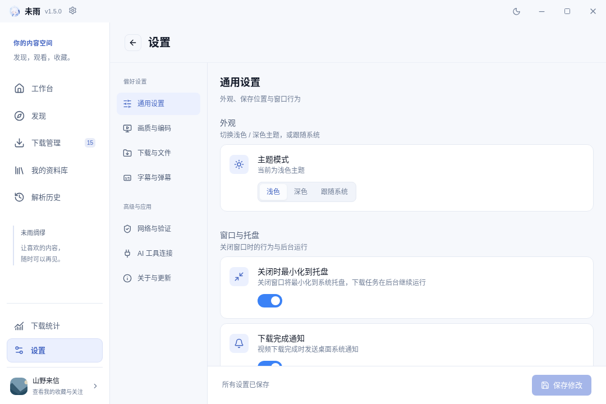
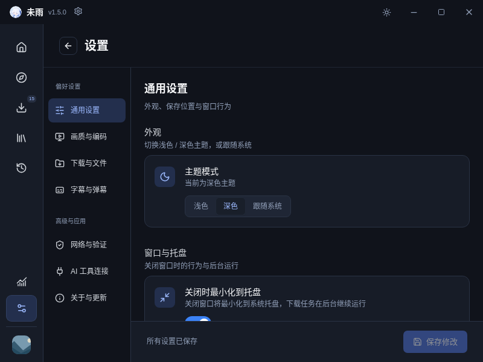

# 工作区界面

左侧导航固定提供工作台、发现、下载管理、我的资料库和解析历史，底部提供下载统计与设置。窗口宽度不超过 1000px 时收成图标栏，每个入口保留提示与可访问名称。发现内容页共用搜索、推荐、排行榜、分区、每周必看与关注动态导航，切换内容不需要回到首页。

工作台保留链接解析入口，同时展示正在下载/排队、已完成记录、解析历史的全库数量，以及最近四条解析记录。点击数量卡片进入对应列表；数量读取失败会显示重试，未加载时不会伪装成零。后台任务状态落库后更新数量，即使任务不在当前分页中。


下载页将批量操作与状态筛选分开，新增排队中分类，显示各状态的全库数量。重试操作明确作用于本页失败任务；快速切换筛选时会忽略旧请求返回的数据。每项任务保留暂停、继续、取消、优先级、重试与打开文件夹等原有操作。



搜索页将不常用的筛选折叠，仍保留已选条件。联想支持上下方向键、Enter 与 Esc，忽略过期请求；搜索提交后不会重新弹出旧联想。个人资料库的标签可横向滚动，未登录时提供明确的登录入口。登录与验证码弹窗在所有页面生效。



设置页按类别导航，内容区独立滚动，底部保存栏始终可见。跨类别编辑保留草稿，切换主题等即时设置不会覆盖尚未保存的输入；保存失败显示错误并保留输入，离开有草稿的设置页会提示是否放弃修改。





以上为生产 React 组件的浏览器预览，使用测试夹具中的虚构账号、记录和本地 SVG 封面。正式应用仍通过 Rust 读取实际数据，预览不代表已经在 Windows WebView2 中验收。

```sh
pnpm typecheck
pnpm build:renderer
pnpm exec playwright install chromium
pnpm test:ui
```

详细夹具说明见 [UI 测试](../tests/player/README.md)。播放器使用本地 H.264/AAC 分片验证真实 MSE；工作区测试使用完整 App 验证导航与保存流程。Windows 托盘、系统目录选择器、真实账号与 B 站网络请求需要在 Windows 桌面环境验收。
